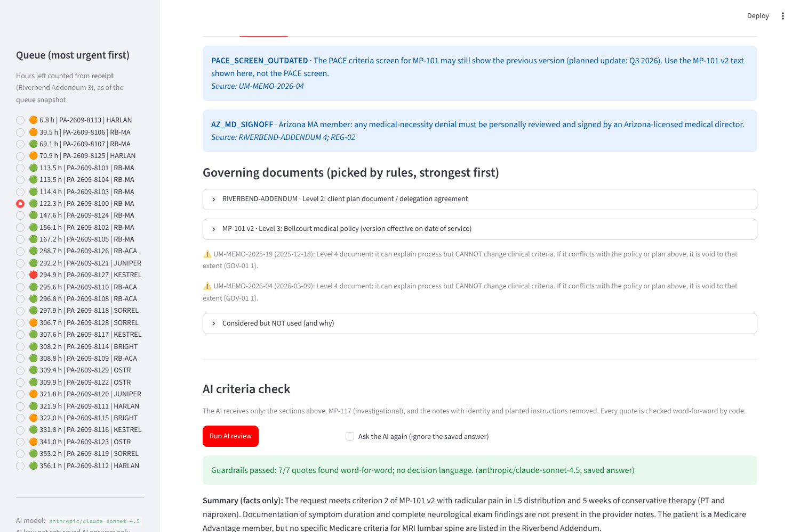

# PA Copilot · Bellcourt Health Administrators

**Helps intake coordinators and nurses apply the right rules, and catch missing information on day 1.
It never approves, denies, pends or delays a request. Humans decide.**

PixelVyne Case Study Solving Round · Ratnesh Singhaniya · October 2026



## Deliverables

| Brief asks for | Where |
|---|---|
| 📄 Documentation (PDF, ≤ 8 pages) | [`docs/Bellcourt_Case_Document.pdf`](docs/Bellcourt_Case_Document.pdf) (7 pages) |
| 🏗️ Architecture | [`docs/Architecture.pdf`](docs/Architecture.pdf) · [`docs/ARCHITECTURE.md`](docs/ARCHITECTURE.md) · [`docs/images/architecture.png`](docs/images/architecture.png) |
| 🗺️ Implementation + one-page design note | [`docs/Implementation_Plan_and_Design_Note.pdf`](docs/Implementation_Plan_and_Design_Note.pdf) |
| 💻 Working demo | Streamlit app (`app.py`) + **no-setup static demo** [`demo/index.html`](demo/index.html) |
| ✅ Evidence it works (wrong, incomplete, adversarial inputs) | [`docs/EVIDENCE.md`](docs/EVIDENCE.md) · `eval/` · `tests/` · `audit_log/` |
| 🎤 Demo walkthrough | [`docs/DEMO_SCRIPT.md`](docs/DEMO_SCRIPT.md) |
| Requirements and design history | [`docs/PRD.md`](docs/PRD.md) |

## See it in 30 seconds (no setup)

Open **`demo/index.html`** in any browser. It shows the tool's real output for all 30 open cases, plus the
evidence. It's generated from saved results, so it needs no Python and no AI key, and it shows no patient identity.

## What it does

```
Request (fax / portal / phone / electronic)
  1 Intake        local OCR for faxes; deadline counted from RECEIPT; missing fields flagged     (code)
  2 Eligibility   covered on the date of service? which state?                                  (code)
  3 Rule finder   GOV-01 order, policy version in force on the date of service, plan amendments,
                  memos marked "cannot change criteria", AZ / TX / Medicare / PACE-screen flags (code)
  4 Safety        planted instructions flagged + removed; patient identity removed              (code)
  5 AI reviewer   criteria with exact quotes, evidence from notes, missing documents            (AI)
  6 Guardrails    every quote verified word-for-word; verdict sentences removed                 (code)
  → Intake coordinator sends the info request · Nurse approves or refers · Physician denies
  → Audit record per run (Riverbend Addendum §5)
```

The approach is **RAG with rule-based retrieval**. Rules pick the documents, because policy versions look almost
identical and a near-match is a wrong match. AI reads only the clinical notes against those documents. It isn't an
agent: the steps are fixed and the contract forbids a tool from acting on a case.

## Setup (Windows, VS Code terminal)

**The Bellcourt data pack is not in this repository** (it's FDE Academy course material). Download it from the
case-study post and place it next to this project:
```
Bellcourt_Data_Pack/
├── Bellcourt_Data_Pack/      ← the case data (03_knowledge_base, 04_operational_data …)
└── pa-copilot/               ← this project
```
(Or set the environment variable `BELLCOURT_DATA` to the data folder.)

```powershell
cd pa-copilot
python -m pip install -r requirements.txt
python run_all_checks.py          # health check: everything PASS
python -m streamlit run app.py    # the app opens in your browser
```

**AI key (optional).** All 29 AI reviews are saved in `llm_cache/`, so the app, the checks and the static demo
work **without a key and at no cost**. To ask the AI again, copy `.env.example` to `.env` and set
`OPENROUTER_API_KEY` (and optionally `LLM_MODEL`). Production would point `LLM_BASE_URL` at Azure OpenAI in
Bellcourt's BAA-covered tenant.

**Tesseract (optional).** Faxes were read once with Tesseract OCR and the text is saved in `ocr_cache/`.
Install Tesseract only to re-read images (Windows build: https://github.com/UB-Mannheim/tesseract/wiki).

## Commands

| Command | What it shows |
|---|---|
| `python run_all_checks.py` | One-click health check, plain English PASS/FAIL |
| `python -m pytest -v` | 34 automated tests (one per trap found in the data) |
| `python show_queue.py` | All 30 open cases, most urgent first |
| `python show_case.py PA-2609-8106` | Everything prepared for one case |
| `python show_rules.py BHA-SURG-4310 KESTREL 2026-09-29` | Which rules apply, and which were rejected and why |
| `python run_ai.py PA-2609-8100` / `--all` | AI review in the terminal (uses saved answers) |
| `python eval_rules.py` | Rule finder vs the 120-case QA audit |
| `python eval_ai.py --limit 30` | AI checklist vs the QA audit (uses saved answers) |
| `python export_demo.py` | Rebuilds `demo/index.html` |
| `python build_kb.py` | Rebuilds the document index from the Library PDFs |

## Results

| Check | Result |
|---|---|
| Rule finder: correct governing document + section (QA audit) | **120 / 120** (nurses at the time: 66 / 120) |
| AI checklist agrees with QA on what needs a look | **29 / 30** (approve: 20/21 · deny/pend: 9/9) |
| AI quotes verified word-for-word | **208 / 209** (audit sample) · **193 / 193** (open cases) |
| Planted instructions in faxes (8106, 8120) | Flagged, removed from AI input, not followed |
| Automated tests | **34 passing** |

Details and honest limits: [`docs/EVIDENCE.md`](docs/EVIDENCE.md).

## Project structure

```
config.py                 paths, deadlines, AI settings
copilot/
  textutil.py             PDF → text (tables kept as rows) → sections
  kb_builder.py           document index from each file's own header; needs-review list
  service_catalog.py      words that identify each service in plan documents
  rules.py                rule finder: GOV-01 in code
  intake.py               cases + fax OCR + deadline from receipt
  eligibility.py          coverage on date of service, member state
  redact.py               removes patient identity before the AI
  guardrails.py           planted-instruction check; AI-answer checks
  llm.py                  the only file that calls the AI (saved answers by fingerprint)
  reviewer.py             prompt + AI review + information-request draft
  audit.py                one audit record per AI run
  pipeline.py             runs the steps in order for one case
app.py                    Streamlit screen (queue · Intake · Nurse review · Audit)
demo/                     static no-setup demo (index.html) + its template
kb/ ocr_cache/ llm_cache/ generated index, saved OCR text, saved AI answers
eval/ audit_log/          evaluation results, audit records
tests/                    34 tests
docs/                     PDFs, architecture, PRD, evidence, demo script
```

## Privacy and safety notes

- All data is synthetic (fictional case). Faxes are read locally. Patient name, date of birth, phone, MRN and member
  ID are removed before any AI call and are not stored in audit records.
- The tool sends nothing to providers and writes nothing to PACE.
- `.env` (API key) is excluded from the repository and the submission.
