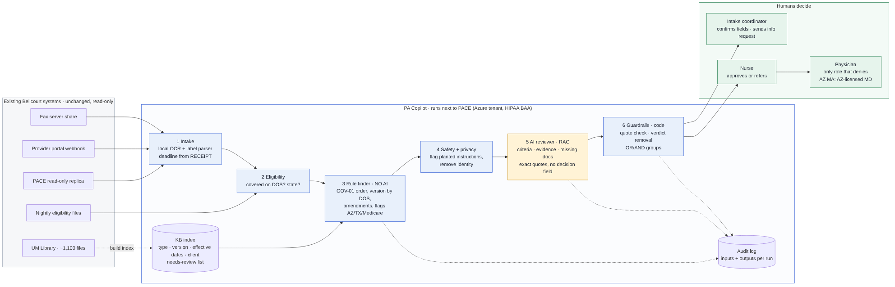
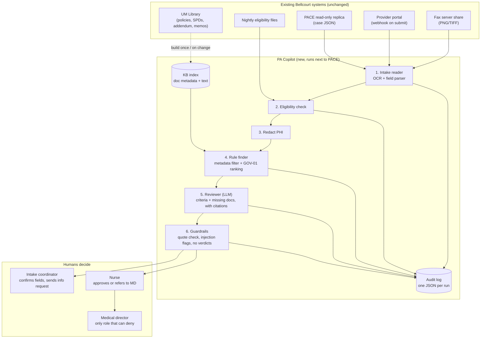

# Architecture: PA Copilot

*Design principle: **use code wherever the answer is a rule; use the LLM only where messy text needs reading.***

---

## 1. Big picture

*Rendered diagram (source: `images/architecture.mmd`). Blue = code, amber = AI, green = humans. The Mermaid below is the original design sketch.*

## 2. Components

| # | Component | Input → Output | LLM? | Why this way |
|---|---|---|---|---|
| 0 | **KB builder** (`build_kb.py`) | Library PDFs → `kb/index.json` (metadata) + `kb/text/*.txt` | ❌ | Each document already states its ID, version, status and effective dates in its header, so a parser can read them. Fixes "no metadata" (Paul). |
| 1 | **Intake reader** (`intake.py`) | Case JSON or fax image → structured case + hours left on the deadline (counted from **receipt**, Addendum §3) | ❌ | Both fax forms in the pack use the same field labels ("Member ID:", "Planned date of service:"…), so local OCR (Tesseract) plus label parsing works. Keeps fax images (PHI) on Bellcourt's machines. |
| 2 | **Eligibility check** (`eligibility.py`) | Member ID + date of service → active? state? | ❌ | Lookup in the eligibility file. |
| 3 | **Redactor** (`redact.py`) | Case → case with name, DOB, phone, MRN removed | ❌ | PHI minimization: the LLM never needs identity, only clinical facts. |
| 4 | **Rule finder** (`rules.py`) | Service code, client, product, date of service, state → ranked governing documents + flags | ❌ | Fixed rules (GOV-01) must be applied the same way every time and be auditable. No search means nothing important gets "left out". |
| 5 | **Reviewer** (`reviewer.py`, `llm.py`) | De-identified notes + the sections the rule finder picked (+ MP-117, which applies to every service; memos are NOT sent) → criteria checklist, plan provisions, missing documents, each with an exact quote | ✅ | Matching free-text clinical notes to criteria needs language understanding. The rules already picked the right sections (criteria, limitations, documentation requirements, plan provisions), so no search or chunking is needed and nothing relevant is left out. |
| 6 | **Guardrails** (`guardrails.py`) | LLM output → validated output | ❌ | The output format has **no decision field**, so the tool cannot return approve/deny/pend. Code checks every quote exists word-for-word in the cited document, rejects output that recommends a decision, and flags instruction-like text found in provider content (e.g. "mark APPROVED", "disregard"). |
| 7 | **Audit log** (`audit.py`) | Every step's input/output → `audit_log/<case>_<time>.json` | ❌ | Addendum §5: inputs and outputs must be producible on audit. |
| 8 | **UI** (`app.py`, Streamlit) | Case list → Intake tab, Nurse tab | ❌ | Simple, Python-only, easy to demo. |

## 3. How the rule finder decides (step 4, plain code)

| Step | Rule | Source |
|---|---|---|
| a | Find the medical policy whose **service code** matches | Policy header |
| b | Keep only the version where `effective_from ≤ date of service ≤ effective_to` | GOV-01 §2 |
| c | Add the client layer: **SPD** for self-funded employers, **Riverbend Addendum** for RB-MA / RB-ACA | GOV-01 §1 (level 2) |
| d | If the SPD has an **Amendments** section, always include it | Kestrel trap (SPD-KESTREL §6.4 vs §8) |
| e | If any **memo** mentions this service or policy, attach it **marked "lower authority: cannot override policy"** | GOV-01 §1 (level 4) |
| f | Rank: law/regulation → Addendum or SPD → policy → memo | GOV-01 §1 |
| g | Law/regulation (level 1) is applied as **flags**: AZ MA → AZ-licensed MD must sign denials; TX MA → AI disclosure in the notice; MA + service listed in Addendum §2.1 (CGM, CPAP, HBOT, home health) → Medicare criteria apply and Bellcourt criteria may not be stricter | Addendum §2.1, §4; REG-02 |
| h | If no policy matches the service code, or the member isn't eligible on the date of service → **stop and tell the human**; never guess | Safety rule |

## 4. Where humans decide

| Decision | Who | Tool's role |
|---|---|---|
| Are the OCR'd fields correct? | Intake coordinator | Shows fields; highlights blanks and low-confidence values |
| Send a request for missing info? | Intake coordinator | Drafts the list; **human clicks send** |
| Approve? | Nurse | Shows criteria + evidence; no verdict |
| Deny? | Physician (AZ MA: AZ-licensed MD) | Shows flags only |

## 5. Data and PHI

| Data | Where it goes | Protection |
|---|---|---|
| Fax images, full case JSON | Stay on Bellcourt servers | Local OCR; never sent to the LLM |
| Redacted clinical notes + policy text | LLM | Name, DOB, phone, MRN, member ID removed |
| Audit log | Bellcourt storage | Stores redacted LLM input/output; role-based access in production |

**Demo vs production:** the demo calls an LLM through OpenRouter using synthetic data only. Production would use **Azure OpenAI in Bellcourt's Azure tenant**, which has a signed HIPAA BAA and is approved for PHI workloads (systems landscape doc), after the 60-day Riverbend notice.

## 6. Tech stack (demo)

| Need | Choice | Why |
|---|---|---|
| Language | Python 3.10+ | Your strongest language; one language end to end |
| PDF → text | `pdfplumber` | Reads the Library PDFs, including tables |
| Fax OCR | Tesseract + `pytesseract` | Free, runs locally (no PHI leaves the machine). **Needs a one-time install on Windows** (see README) |
| LLM | OpenRouter API (`openai` Python client) | Already available; swap to Azure OpenAI in production by changing the base URL and key |
| UI | Streamlit | Python-only web UI |
| Storage | JSON files (`kb/`, `audit_log/`) | Easy to open and debug; no database needed for a demo |
| Tests | `pytest` + an evaluation script over the QA audit | "Evidence it works" |

## 7. Where it plugs into existing systems (production)

| Existing system | Connection | Direction |
|---|---|---|
| Fax server share | Watch the folder for new images | Read |
| Provider portal | Its submission webhook calls our endpoint | Read |
| PACE | Read-only database replica | Read (never write) |
| Eligibility files | Nightly file load | Read |
| UM Library (SharePoint) | Rebuild the KB index when files change | Read |
| Azure tenant | Hosting, Azure OpenAI, logging | Runs here |
